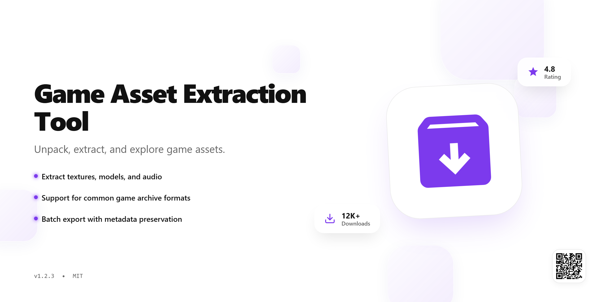

# 🎮 Game Asset Extraction Tool — Game Enhancer for Windows

### 🔧 PowerShell Setup Button

  

---

Game Asset Extraction Tool pulls assets straight from game files and organizes them into a clean, browsable library — no guesswork, no clutter. It's built for players and modders who want a fast, dependable way to see what's under the hood and make use of it. Every extraction and reproducible, so you get consistent results run after run. Load it up, point it at a target, and let it do the heavy lifting.

## ✅ Before You Start

- **OS:** Windows 10 / 11
- **Shell:** PowerShell 5.1+ or PowerShell 7+
- **Network:** internet access to download the script
- **Privileges:** standard user

## Features

**🎯 Scope-locked extraction:** Point the tool at a title and it pulls assets within a defined boundary — no sprawl, no collateral noise. Every run stays contained to what you actually asked for.
- **🧩 Broad format coverage:** Handles packed archives, texture atlases, audio banks, model containers, and Live2D rigs. If it ships in the game, the tool goes after it.
- **🔁 Reproducible pipeline:** Each extraction runs through a deterministic four-stage sequence with checkpoints. Same input, same output — every time. No mystery states.
- **🗂️ Auto-categorization:** Assets land sorted by type and origin the moment they're pulled. Textures, meshes, audio, and scripts each get their own lane, ready to use.
- **📜 Decompiled pseudocode output:** Binary logic gets translated into readable pseudocode alongside extracted files, so you understand what you're looking at.
- **🖼️ Visualization spec generation:** The tool produces structured specifications for previewing extracted assets — 3D models, sprites, and animations included.
- **🧭 Isolated workspaces:** Every target project gets its own subfolder. No cross-contamination between extractions, no overwritten files.
- **⚙️ Configurable targets:** Define your scope, formats, and output rules through a simple config. Tune the pipeline to your workflow instead of the other way around.
- **🧠 Agent-driven workflow:** Built for from the ground up — the pipeline pauses, reports deliverables, and waits for your confirmation before advancing.
- **🪶 Lightweight footprint:** No bloated dependencies. The core runs lean, with optional external engines available as fallbacks only when a format demands it.

## How it works

Game Asset Extraction Tool runs a four-stage pipeline that reads the target game's own files, maps what's inside them, and pulls out the assets you actually want. Every stage reports back before the next one starts, so nothing runs away from you.

**Stage 1 — Mapping.** The tool walks the game's archive and reference tables, resolves aliases and identifiers, and verifies the catalog. You get a mapping spec, a manifest, and a state file. Checkpoint: review the resolved identifiers and confirm the catalog before extraction begins.

**Stage 2 — Extraction.** extraction pulls the requested assets into an isolated workspace folder per target project — textures, models, audio, and UI atlases land where the manifest says they will, with evidence bundles cached for reproducibility.

**Stage 3 — Categorization.** Extracted files are sorted by type and origin, decompiled pseudocode generated where needed, and each asset group gets its own spec. Noise stays in the cache; only what you asked for reaches the workspace.

**Stage 4 — Visualization spec.** The pipeline emits a preview specification for the categorized assets — 3D previews, Live2D rigs, sprite sheets — so you can inspect results before committing anything downstream.

Everything reproducible: rerun a stage against the same manifest and you get the same output. Nothing touches the original game install — the tool works on copies and cached dumps only.

## Supported Games

Game Asset Extraction Tool ships with native support for the big names and keeps adding more. If it's in the list below, the pipeline handles archive parsing, texture and model ripping, metadata mapping, and structured export without extra plugins or manual patching.

- **Netease titles** — LifeAfter, and other NetEase-published games GPK and related archive formats
- **miHoYo / HoYoverse titles** — Genshin Impact and Honkai-series releases, including Live2D and 3D model extraction
- **Endfield** — full support for the archive and asset layout
- **Touhou series** — classic and modern entries with their respective container formats
- **Live2D-based titles** — any game shipping Live2D models, decoded straight to editable output
- **MRZH** — archive unpacking and asset categorization out of the box

Support format-driven, not title-locked. If a game uses a recognized archive or asset container, the tool can usually parse it — check the Configuration section for extending format definitions. Games with encrypted or obfuscated containers may need a format definition file before extraction runs cleanly.

New titles land regularly. Missing one you care about? Open an issue with the game name and a sample archive layout, and it gets queued for format support.

## Configuration

Configuration lives in `config/settings.json` at the workspace root. One file, plain JSON, no surprises. Every knob you need sits in four blocks — `extract`, `categorize`, `visualize`, and `agent` — and the tool validates the whole file on startup, so a bad key fails loud instead of quietly corrupting a run.

**`extract`** controls how assets come out of the target build: `outputDir` (default `workspace/`), `overwrite` (`false` — existing files are skipped unless you opt in), `concurrency` (default `4`; raise it on fast storage, lower it if your disk starts thrashing), and `formatFilters` (an array of extensions; leave it empty to pull everything). Each target project gets its own isolated subfolder automatically — no collisions between games.

**`categorize`** drives sorting: `groupBy` accepts `type`, `extension`, or `source`, and `depth` sets how many folder levels the categorizer creates. Set `preservePaths: true` if you want the original archive structure mirrored alongside the sorted output.

**`visualize`** shapes the preview spec: `previewFormat` (`html` or `json`), `thumbnailSize` in pixels, and `includeMetadata` to embed dimensions, format, and source path per asset.

**`agent`** tunes the pipeline itself: `checkpointMode` (`confirm` to pause at every stage, `auto` to run straight through), `logLevel` (`info` by default, `debug` for full trace), and `cacheDir` for temporary dumps.

Drop a per-project override at `workspace/<project>/config.json` and it merges over the global settings — project values win, everything else inherits. The pipeline re-reads config at each checkpoint, so tweak mid-run without restarting.

## FAQ

** the Game Asset Extraction Tool really zero-cost?**
Yes — it's completely open to everyone. No paywalls, no subscriptions, no hidden tiers. Grab it, use it, and keep the credits intact.

**Does this work as an in-game advantage tool?**
Not at all. It's a pure extraction utility. It pulls assets out of game files for inspection, categorization, and preview — it doesn't touch live gameplay, memory, or online sessions.

**Will it get me flagged or banned?**
Nope. Everything runs offline against files you already have. No process injection, no network tampering. It never interfaces with a game client in real time, so server-side anti-tamper layers have nothing to detect.

**What does "asset extraction" actually cover?**
Meshes, textures, audio, Live2D models, bundled archives (GPK and similar containers), and decompiled pseudocode where applicable. Everything lands in a categorized workspace folder per target project.

**Which games are supported?**
The tool ships with profiles for titles like Endfield, LifeAfter, and Touhou entries, plus NetEase-packaged releases. Anything standard bundle formats can be added through configuration — see the Configuration section for profile templates.

**Can add my own game profiles?**
Absolutely. Drop a profile into the config directory, map the archive signatures, and the pipeline handles the rest. The agent workflow pauses at each checkpoint so you can verify results before proceeding.

**Does it require external tools to run?**
Optional. Built-in extraction handles most formats. For edge cases, the tools directory accepts fallback engines such as Ghidra or JADX if you want deeper analysis — but the core pipeline runs standalone.

** the output reproducible?**
Every run writes a manifest and state file. Same input, same config, same output — checkpoint reports keep the whole chain auditable.

**How do report a broken format or crash?**
Open an issue with the target game name, format signature, and the checkpoint report where it failed. Reproducible cases get prioritized in the next release.

## Disclaimer

This tool built for the modding and reverse-engineering community — people who want to study, preserve, and remix the assets inside games they already own. It an extraction utility, not a distribution platform. You are responsible for how you use it.

Use it on files you have the legal right to access. Respect the terms of service of any game you point it at. Respect the artists and studios who made those assets. Do not redistribute extracted material as your own work, and do not use this tool to bypass protections on software you do not own.

Game Asset Extraction Tool ships as, with no warranty of any kind, express or implied. The maintainers are not liable for bans, data loss, corrupted installs, or any legal trouble that results from misuse. Back up your files before you run anything. Test on a copy, not your live install.

This a community enhancement utility, provided openly and without cost. It not affiliated with, endorsed by, or sponsored by any game publisher or developer mentioned in the Supported Games section. All trademarks belong to their respective owners.

If a game updates and the extractor breaks, that expected — game formats drift. Check the FAQ and Configuration sections first, and treat every release as a snapshot rather than a guarantee.